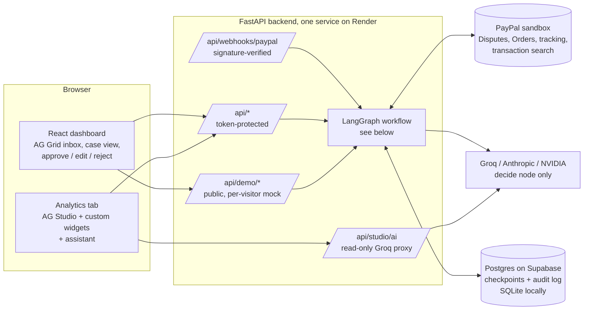
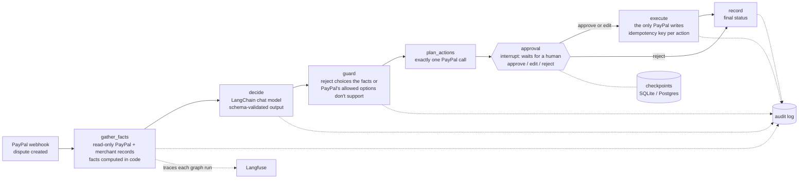

# Rebuttal

An AI agent that resolves PayPal disputes for small online shops before they turn into claims.

When a buyer opens a dispute, Rebuttal pulls the order, shipment tracking, transaction history and store policies,
works out what actually happened, and proposes the cheapest fair resolution: share tracking, offer a replacement,
refund after a return, accept quickly, or submit evidence. If the purchase was made by the buyer's AI shopping
assistant, it compares what the assistant was told to buy with what it ordered. Nothing reaches PayPal until the
merchant approves, and every step is logged.

Built for the PayPal AI Hackathon (Devpost), Oct-Nov 2026. Sandbox only: the code refuses to run against live PayPal.

## Try it in 60 seconds (judges)

**Live demo, no token, no PayPal account:** <https://rebuttal-oq3g.onrender.com/#demo>

1. Open the link. The service runs on Render's free plan, so the first load can take about 50 seconds if it was idle.
2. The page creates a private demo session with six seeded disputes. The hero case, row PP-D-2000 ("Not as described"),
   is already open, analyzed and waiting for you (case id `agent_wrong_size`).
3. Read the facts (assistant said "medium", the seller shipped a large), the decision (a refund after the return) and
   the drafted message. The demo uses the offline rules reasoner, so no model runs in it.
4. Edit one line if you like, then approve. One PayPal call goes out, to an in-memory mock sandbox. Open the audit
   trail to see every step.
5. Add any of the 20 labeled disputes from the simulator, or click **Reset demo**.

A demo session uses the in-memory PayPal mock and the offline rules reasoner: no model, no keys, no database. It never
reaches the real PayPal client or the real runtime. Routes, limits and tests: [docs/demo-mode.md](docs/demo-mode.md).

**Run it locally** (needs [uv](https://docs.astral.sh/uv/) and Node.js; nothing below needs a key). Terminal 1:

```bash
cd backend
uv sync                                    # creates .venv from the lockfile (Python 3.12)
REBUTTAL_MOCK=1 REBUTTAL_REASONER=rules REBUTTAL_API_TOKEN= DATABASE_URL= REBUTTAL_CHECKPOINT_URL= \
  REBUTTAL_CORS_ORIGINS=http://localhost:5173 uv run uvicorn rebuttal.app:app --port 8000
```

Terminal 2:

```bash
cd frontend
npm install
npm run dev                                # then open http://localhost:5173/#demo
```

Backend only, no browser:

```bash
cd backend
uv run pytest                              # tests: never call a model, never send traces
uv run python -m evals.run --rules         # eval suite, offline baseline; prints only (--save writes evals/results/ and RESULTS.md)
uv run python -m scripts.demo              # the agent handles 6 demo disputes end to end; prints only (--save writes preview_data.json)
REBUTTAL_MOCK=1 REBUTTAL_REASONER=rules REBUTTAL_API_TOKEN= DATABASE_URL= REBUTTAL_CHECKPOINT_URL= \
  REBUTTAL_CORS_ORIGINS=http://localhost:5173 uv run uvicorn rebuttal.app:app --port 8000   # API docs on http://127.0.0.1:8000/docs
```

None of these change a tracked file, so `git status` stays clean.

The dashboard's own commands (build, lint, Playwright) are in [frontend/README.md](frontend/README.md).

## Status

Working prototype. It runs against an in-memory mock of the PayPal sandbox out of the box, and the real sandbox is
wired too: the Disputes API (read, message, offer) has been exercised against it by hand
(`backend/scripts/spike_sandbox.py`). See [PLAN.md](PLAN.md) for the road to submission.

Live end to end (Oct 7, 2026): deployed on Render with Groq and Supabase Postgres, a dispute filed by a buyer in the
real PayPal sandbox arrived as a signature-verified webhook, the agent gathered the facts and drafted a resolution,
and the proposal is waiting for approval in the checkpointed workflow. No PayPal writes happened before approval.

976 backend tests, 96% combined line and branch coverage (`cd backend && uv run pytest --cov --cov-branch`; CI prints it on every run).
CI also runs ruff, gitleaks, CodeQL, OSV-Scanner and OpenSSF Scorecard, and the Playwright end-to-end tests.

Not verified live: an approved write to the real PayPal sandbox through the deployed app (the hero dispute was
analyzed live and left unapproved on purpose), and the AG Studio assistant against a live Groq key (tested with mocks
only).

## Architecture

The system:



The workflow is a [LangGraph](https://docs.langchain.com/oss/python/langgraph) graph
([`agent/graph.py`](backend/rebuttal/agent/graph.py)). Every step is plain, deterministic code except `decide`, the
only node that calls a model.



Where things live:

- `rebuttal/paypal/client.py`: typed PayPal REST client (Disputes, Orders, tracking, transaction search, webhooks). It
  refuses any write outside `permit_writes()`, and `read_only()` gives the analysis steps a clone whose transport
  refuses everything but GET.
- `rebuttal/paypal/mock.py`: in-memory sandbox behind `httpx.MockTransport`; the same client runs against both.
- [`rebuttal/agent/toolkit.py`](backend/rebuttal/agent/toolkit.py): the read-only, PayPal-Agent-Toolkit-shaped tool
  layer for showing a dispute, listing transactions, order trackers and capture-to-order lookups. `gather` in
  `facts.py` reads PayPal only through it.
- `rebuttal/agent/`: `facts.py` (gather + hard facts), `llm.py` (LangChain chat models, Pydantic `DecisionOut`),
  `reasoner.py` (rules baseline, `guard`, prompt), `pipeline.py` (planning, evidence PDF), `graph.py` (the graph).
- `rebuttal/approval.py`: the approval interrupt and the `execute` node, the only code that writes to PayPal.
- `rebuttal/analytics.py` and `rebuttal/studio_ai.py`: the read-only analytics API and the assistant proxy.
- `frontend/`: React + Vite + TypeScript dashboard. `preview/` holds the static design target it follows.
- `evals/cases.json`: 20 labeled disputes, 4 marked hard (the buyer's wording changes the right answer).

## Safety design

Rebuttal moves money-adjacent state at a payment company, so the safety rules are code and tests, not promises. The
decisions are written up as short records in [docs/adr/](docs/adr/README.md).

1. **One write path.** Only the graph's `execute` node in `rebuttal/approval.py` may call PayPal write endpoints
   (message, offer, evidence, accept, escalate, appeal). A test scans the package so nothing else can. [ADR 0001](docs/adr/0001-single-paypal-write-path.md).
2. **Read-only analysis.** Analysis steps hold `client.read_only()`, a clone whose HTTP transport refuses anything but
   GET. The full client raises on any write outside `permit_writes()`. [ADR 0002](docs/adr/0002-read-only-client-for-analysis.md).
3. **Facts in code, guard over the model.** Facts (delivered? inside the return window? duplicate charge?) are computed
   in `agent/facts.py`. The model only interprets words and drafts text, and its output is validated against a Pydantic
   schema. `guard()` rejects any choice the facts or PayPal's allowed options do not support. [ADR 0004](docs/adr/0004-facts-in-code-guard-over-model.md).
4. **Human approval.** The workflow stops at a LangGraph `interrupt()`. Only an approve or edit decision routes to
   `execute`, which refuses to run without one. [ADR 0003](docs/adr/0003-human-approval-via-interrupt.md).
5. **Deterministic `PayPal-Request-Id` and audit log.** Every approved write carries a request id derived from the
   proposal id, action index and kind, and every agent step and write is appended to the audit log. [ADR 0005](docs/adr/0005-deterministic-request-id-and-audit-log.md).
6. **Honest evals.** Two held-out sets, written blind to the guard and facts code. [ADR 0007](docs/adr/0007-held-out-evals.md).

Two tests that must stay green: `backend/tests/test_write_boundary.py` and
`backend/tests/test_core.py::test_analyze_never_writes_to_paypal`.

### Payments-grade guarantees

What the code enforces today, and where. Nothing here is a claim about PayPal's side beyond what is stated.

| Guarantee | How | Code |
|---|---|---|
| **Human approval before any money movement** | `analyze` stops at a LangGraph `interrupt()`; only an approve or edit decision routes to `execute`, which also refuses to run without one. Three layers keep writes in one place: analysis steps hold `client.read_only()`, whose HTTP transport refuses anything but GET; the full client raises on any write unless the caller is inside `permit_writes()`, which only `execute` (and named manual sandbox scripts) enter; and a test scans the package, scripts and evals for any other way to reach a write. A proposal can only be approved by its exact id, so a stale or newer proposal is never approved by mistake, and nothing fallible runs after the human's answer is read, so a failure cannot turn one answer into another. | [`approval.py`](backend/rebuttal/approval.py), [`graph.py`](backend/rebuttal/agent/graph.py), [`client.py`](backend/rebuttal/paypal/client.py), [`test_write_boundary.py`](backend/tests/test_write_boundary.py), [`test_graph.py`](backend/tests/test_graph.py) |
| **Idempotency keys on every PayPal write** | Every POST carries a `PayPal-Request-Id`. For approved actions it is deterministic (a UUID derived from proposal id, action index and kind), so a retry is the same request. Caveat: PayPal's OpenAPI specs document this header for Orders and Payments but not for the Disputes endpoints, so it is not relied on there. Before sending, `execute` reads the dispute and skips a message or offer that already landed (a retry after a crash), nothing fallible runs after the PayPal call, and a per-dispute lock allows one approval at a time, across threads and processes (file locks for SQLite; Postgres advisory locks are written but not yet run against a live database). Evidence and accept-claim are not reconciled: `execute` sends them only while PayPal waits for the seller, so a retry after a send that landed fails closed (FAILED, nothing sent this time); check the dispute. | [`idempotency_key`, `already_applied`, `execute`](backend/rebuttal/approval.py), [`DisputeLocks`](backend/rebuttal/persistence.py), [`_request`](backend/rebuttal/paypal/client.py), [`test_graph.py`](backend/tests/test_graph.py) |
| **Resumable workflows (checkpointing)** | Each dispute is a LangGraph thread (`thread_id` = dispute id) checkpointed at every step with `durability="sync"`. A proposal waiting for approval survives a restart; a crash after approval is continued with `retry`; a run that stops part-way is reported as INTERRUPTED, never as approvable. Tested with a SQLite file, in the same process and across two real processes. Postgres (Supabase) is exercised live: by `backend/tests/live_postgres.py` across separate processes, and by the deployed app, which paused a real sandbox dispute at the approval gate. | [`persistence.py`](backend/rebuttal/persistence.py), [`graph.py`](backend/rebuttal/agent/graph.py), [`test_graph.py`](backend/tests/test_graph.py) |
| **Schema-validated model output** | The model returns a Pydantic `DecisionOut` through `with_structured_output` (native JSON schema on Anthropic and Groq): unknown resolutions are rejected, numbers are clamped. Humans' decisions are validated too (`ApprovalDecision`). Anything invalid falls back to the rules baseline and says so. `guard` then checks the choice against the computed facts and PayPal's allowed options. | [`llm.py`](backend/rebuttal/agent/llm.py), [`reasoner.py`](backend/rebuttal/agent/reasoner.py), [`test_llm.py`](backend/tests/test_llm.py) |
| **Persistent audit log** | Every agent step and every PayPal write is appended to the audit log with the idempotency key: the `rebuttal_audit` table in Postgres when `DATABASE_URL` is set (next to the checkpoints, so it survives redeploys), otherwise a local JSONL file. | [`audit.py`](backend/rebuttal/audit.py) |
| **Webhook signature verification** | Every delivery to `/api/webhooks/paypal` is checked with PayPal's `verify-webhook-signature` call against `PAYPAL_WEBHOOK_ID` before anything happens (401 if forged, 503 if PayPal cannot be reached). With no webhook id set, only the local mock accepts deliveries; a real sandbox refuses them. A webhook can only start an analysis, which cannot write to PayPal. | [`app.py`](backend/rebuttal/app.py) |
| **Evals** | 20 labeled disputes, 4 hard, plus two held-out sets of 10. The report also counts PayPal writes before approval (must be 0). | [`evals/`](backend/evals), [`RESULTS.md`](backend/evals/RESULTS.md) |
| **Tracing** | Optional [Langfuse](https://langfuse.com) tracing of every graph run, tagged with dispute id and model, one session per dispute; the eval cases are a Langfuse dataset and each eval run is an experiment with a correct/incorrect score per case. Off unless the keys are set. Traces (like checkpoints) contain the case snapshot, including the buyer's name, email and address, so keep tracing off or self-hosted for anything but sandbox and test data (email addresses are masked, names and addresses are not). | [`tracing.py`](backend/rebuttal/tracing.py), [`evals/run.py`](backend/evals/run.py) |

### PayPal Agent Toolkit (read-only)

Rebuttal does not depend on PayPal's official `paypal-agent-toolkit` package (v1.11.0 on PyPI), for four verified reasons:

1. It pins `langchain==0.3.23` (and `openai-agents==0.0.2`, `crewai-tools==0.13.2`), which cannot resolve with the `langchain>=1.4.3` that our LangGraph 1.x stack uses.
2. Its `PayPalAPI.run(method, params)` runs any tool by name, including `accept_dispute_claim`, `create_order` and `pay_order`, without checking the configured actions, so choosing read tools in `get_tools()` is not a hard boundary.
3. It sends requests with `requests` directly, so our read-only HTTP transport and the mock sandbox cannot gate it.
4. Its `list_transactions` does not request `fields=all`, so the payer email needed for the duplicate-charge fact is not returned.

`rebuttal/agent/toolkit.py` is therefore a substitute with the same tool shape (`method`, `name`, `description`, `args_schema`, `actions`, `execute`; `run(method, params)` returns a JSON string), tools named like the toolkit's (`get_dispute`, `list_transactions`) plus Rebuttal's `get_order_trackers` and `get_capture_order_id`, all over `PayPalClient.read_only()`. Only these four read tools exist; any other name raises `ToolNotAvailable`. The official package could replace it only after its langchain pin is lifted and PayPal fixes reasons 2 to 4 upstream. Record: [ADR 0008](docs/adr/0008-read-only-paypal-toolkit-adapter.md).

The write path is unchanged: `execute` in `rebuttal/approval.py` is still the only writer in the agent graph and the API (the named manual sandbox and demo scripts in `backend/scripts/` are the exception). The adapter calls only the four read methods. It is covered by `backend/tests/test_toolkit.py`, `backend/tests/test_gather_toolkit.py` (every `gather` read goes through it) and the package scan in `backend/tests/test_write_boundary.py`.

## Eval results

Numbers are copied from [`backend/evals/RESULTS.md`](backend/evals/RESULTS.md); that file is the source of truth and
has the per-case tables. **Model alone** is the model's own choice before `guard()`; **final** is what the agent would
propose after the guard. All model runs below are on Groq, `qwen/qwen3.8-27b`, unless a row says otherwise. Gate
violations (PayPal writes before approval) are 0 in every run.

| Set | Date | Model | Model alone | Final (model + guard) | Standard | Hard | Guard changed | Tokens |
|---|---|---|---|---|---|---|---|---|
| Main set (20 cases, used for tuning) | 2026-10-14 | groq qwen/qwen3.8-27b | 75% (15/20) | 95% (19/20) | 94% | 100% of 4 | 4/20 (20%) | 27,532 |
| Main set | 2026-10-07 | groq qwen/qwen3.8-27b | final only | 90% (18/20) | 88% | 100% of 4 | n/a | 27,146 |
| Main set | 2026-10-07 | groq qwen/qwen3.8-27b | final only | 85% (17/20) | 81% | 100% of 4 | n/a | 27,199 |
| Main set | 2026-10-07 | nvidia z-ai/glm-5.3 | final only | 100% (20/20) | 100% | 100% of 4 | n/a | 53,138 |
| Main set | 2026-10-07 | nvidia z-ai/glm-5.3-flash | final only | 95% (19/20) | 94% | 100% of 4 | n/a | 59,808 |
| **Held-out 1** (10 cases, not tuned against) | 2026-10-09 | groq qwen/qwen3.8-27b | 80% (8/10) | 100% (10/10) | 100% | 100% of 3 | 2/10 (20%) | 13,685 |
| **Held-out 2** (10 cases, one case later fixed, see notes) | 2026-10-10 | groq qwen/qwen3.8-27b | 80% (8/10) | 100% (10/10) | 100% | 100% of 6 | 2/10 (20%) | 13,979 |

Offline rules baseline (no model, `uv run python -m evals.run --rules`, re-run Oct 14, 2026 for this README): model
alone 75%, final 85% overall, 100% standard, 25% hard (4 cases). The hard cases are what the model has to win.

Read these honestly:

- The main set was used to develop the guard and facts code, so its score is a development number. The held-out
  numbers are the honest ones. Samples are small (10 cases each).
- On Oct 18 the rules baseline and `guard()` were fixed after Held-out 2 showed a double refund
  (`ho2_dup_already_refunded`); the Oct 10 numbers predate the fix, and later results on that case are not blind.
- Scores swing 75-95% from run to run on the main set.
- `snad_outside_window` is a judgment call (a partial refund is defensible).
- On Oct 18 Held-out 2 showed `ho2_inr_unit_format` reported as a misdelivery. The fix (R16) normalises street suffixes and unit markers, and an address written differently but with the same house number, ZIP and city is "uncertain" and is not converted into a replacement. The fix is not merged yet, so the case still misses until R16 lands. Later results on that case are not blind.
- The gap between "model alone" and "final" is the guard at work. In the held-out runs the guard's changes turned
  OFFER_REPLACEMENT, an offer type PayPal does not allow on those disputes, into OFFER_RETURN_FOR_REFUND, and on
  `ho2_inr_nothing_shipped` (nothing shipped, so no delivery can be proved: `cannot_prove_delivery`) into ACCEPT_CLAIM.

`uv run python -m evals.run --langfuse` records a run as a Langfuse experiment (needs the Langfuse keys).

## Sponsor tools and PayPal APIs

**AG Grid / AG Studio** (main prize target).
- The inbox is an AG Grid Community grid ([`frontend/src/components/Inbox.tsx`](frontend/src/components/Inbox.tsx)),
  with only the five grid modules it uses.
- The **Analytics** tab is an AG Studio 3.0.0 dashboard (`ag-studio`, `ag-studio-react`), lazy-loaded. It has four
  custom widgets registered with `createWidgets` (ranked bars, money split, deadline list, model-vs-final agreement),
  and a Studio theme built from the design tokens, in light and dark. Data comes from the read-only
  `GET /api/analytics`.
- The **assistant** uses the Studio Agent Framework: an "Ask the assistant" button opens Studio's AI panel (Studio shows
  it in edit mode). Studio ships no model, so the adapter ([`studioAiAdapter.ts`](frontend/src/components/analytics/studioAiAdapter.ts))
  talks to a token-protected, read-only backend proxy to Groq ([`studio_ai.py`](backend/rebuttal/studio_ai.py)). The key
  stays on the server, the proxy cannot reach PayPal, and it shares the dispute agent's Groq budget
  ([ADR 0010](docs/adr/0010-studio-assistant-proxy.md)). It is hidden when no Groq key is set. **Verified with mocks; one
  tiny live Groq call through the proxy succeeded, but no full Studio turn with tools has run.**
- Licence: Studio runs unlicensed. Its console banner shows, and the documented watermark was not seen in our one
  screenshot check. AG Grid confirmed on Discord that the watermark is not penalized (for AG Grid; whether it covers
  Studio specifically is not independently verified). The AI module setup and the licence
  notes are in [frontend/README.md](frontend/README.md). Details and open items: [docs/ag-studio.md](docs/ag-studio.md).

**APIMatic Context Plugin for PayPal** ([`paypal@context-plugins-local`](https://github.com/paypaldev/server-sdk-context-plugin-preview)).
We installed it on 2026-10-06 and used it while building the PayPal integration in Claude Code. The honest record is
[docs/apimatic-log.md](docs/apimatic-log.md): two logged uses, both checks of our hand-written client against the
APIMatic-generated PayPal Server SDK models. The first found no drift in our Orders v2 payloads and carrier values. The
second found the SDK has no Disputes controller, so it could not confirm the dispute-creation body. The SDK covers orders, payments, vault, subscriptions and transaction search, not disputes, which is most of
what Rebuttal calls.

**PayPal APIs used** (all sandbox; see [`client.py`](backend/rebuttal/paypal/client.py)):
- Disputes: list and show a dispute, send message, make offer, provide evidence, accept claim, escalate,
  appeal (`/v1/customer/disputes/...`). Sandbox-only helpers for the simulator and manual scripts: create dispute (as a second
  sandbox business account acting as buyer), require-evidence, adjudicate.
- Orders v2 and payments: show order, capture lookup, create and capture order, add shipment tracking
  (`/v2/checkout/orders/...`, `/v2/payments/captures/...`).
- Transaction search (`/v1/reporting/transactions`), webhook events and `verify-webhook-signature`
  (`/v1/notifications/...`), and the OAuth token call.
- Webhook events `CUSTOMER.DISPUTE.CREATED`, `UPDATED` and `RESOLVED` are registered; only CREATED starts an analysis.
- PayPal Agent Toolkit: its read-only tool shape, as an adapter (see above), not the package.

**Other tools.** Render (hosting), Supabase (free Postgres), Groq (the live model), Langfuse (optional tracing),
LangGraph and LangChain. Bryntum Scheduler and Elastic retrieval were planned as backups and are not part of the
build.

## Configuration

Configuration lives in `backend/.env` (copy `backend/.env.example`; the file is git-ignored):

| Setting | What it does |
|---|---|
| `ANTHROPIC_API_KEY`, `GROQ_API_KEY`, `NVIDIA_API_KEY` | Pick the model that decides, first one set wins in that order. `REBUTTAL_MODEL` / `GROQ_MODEL` / `NVIDIA_MODEL` name the model. |
| `REBUTTAL_REASONER=rules` | Never call a model, whatever keys are set. |
| `PAYPAL_CLIENT_ID`, `PAYPAL_CLIENT_SECRET`, `REBUTTAL_MOCK=0` | Run against the real PayPal **sandbox** (anything else is refused). |
| `PAYPAL_WEBHOOK_ID` | The id PayPal gives the webhook you register for `/api/webhooks/paypal`; deliveries are verified against it. |
| `REBUTTAL_API_TOKEN` | When set, every `/api` route except health, the PayPal webhook and the public demo under `/api/demo` (each demo session reaches only its own mock) needs `Authorization: Bearer <token>`. Whoever can call approve is the human in the approval gate, so set it on any deployment. |
| `DATABASE_URL` | A `postgresql://` URL (we use a free Supabase project, session pooler on port 5432; needs `uv sync --extra postgres`). Paused proposals and the audit log then live in Postgres. Mock mode ignores it unless `REBUTTAL_MOCK_USE_DATABASE=1` (an explicit `REBUTTAL_CHECKPOINT_URL` still applies). Unset: SQLite, so no setup is needed to run locally. |
| `REBUTTAL_CHECKPOINT_URL` | Override for the checkpoints only: a SQLite file or a `postgresql://` URL. Default: in memory in mock mode, `checkpoints.sqlite` against the real sandbox. |
| `LANGFUSE_PUBLIC_KEY`, `LANGFUSE_SECRET_KEY`, `LANGFUSE_BASE_URL` (or `LANGFUSE_HOST`) | Turn on Langfuse tracing. Off when unset; `REBUTTAL_TRACING=0` forces it off. |

Deploying: [docs/deploy.md](docs/deploy.md) and [`render.yaml`](render.yaml).

## Architecture decisions

The main design decisions (single write path, read-only analysis, approval interrupt, facts over model, idempotency and audit, persistence, held-out evals, [read-only PayPal toolkit adapter](docs/adr/0008-read-only-paypal-toolkit-adapter.md), [isolated judge demo runtime](docs/adr/0009-isolated-judge-demo-runtime.md), [Studio assistant proxy](docs/adr/0010-studio-assistant-proxy.md)) are recorded in [docs/adr/](docs/adr/README.md).

## Credits

Rebuttal stands on open-source packages. Versions are in `backend/pyproject.toml` / `backend/uv.lock` and
`frontend/package.json` / `frontend/package-lock.json`.

- Backend: [FastAPI](https://fastapi.tiangolo.com), [Uvicorn](https://uvicorn.dev), [httpx](https://www.python-httpx.org),
  [Pydantic](https://docs.pydantic.dev), [LangGraph](https://github.com/langchain-ai/langgraph) (with its SQLite and
  Postgres checkpointers), [LangChain](https://github.com/langchain-ai/langchain) (core, Anthropic, Groq, OpenAI-compatible),
  [Langfuse](https://langfuse.com), [fpdf2](https://github.com/py-pdf/fpdf2) (evidence PDFs), psycopg.
- Dev tools: pytest, pytest-cov, ruff, [uv](https://docs.astral.sh/uv/).
- Frontend: [React](https://react.dev), [Vite](https://vite.dev), TypeScript, [AG Grid Community](https://www.ag-grid.com)
  (MIT), [AG Studio](https://www.ag-grid.com/studio/) (commercial, run unlicensed, see above),
  Playwright, oxlint.
- Fonts from Google Fonts: Bricolage Grotesque, Public Sans, JetBrains Mono.
- Services: PayPal sandbox, Render, Supabase, Groq.

## License

MIT. See [LICENSE](LICENSE).
